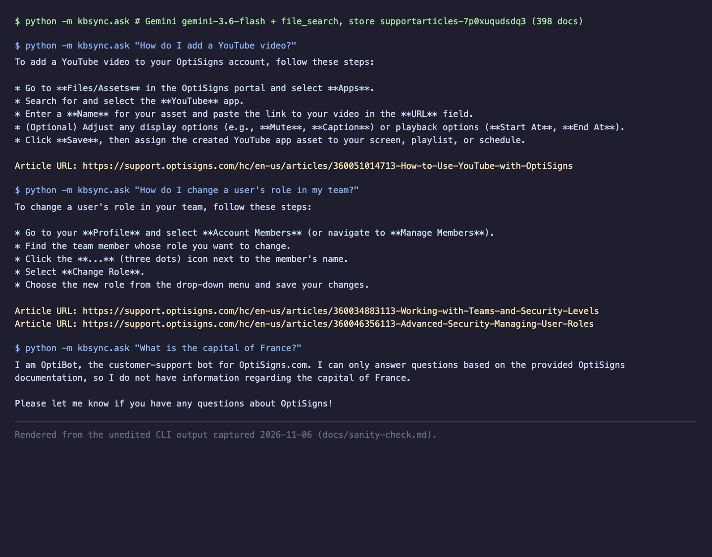

# Support-article sync job

Scrapes a Zendesk Help Center, converts articles to clean Markdown, and keeps a
Gemini File Search store in sync once per day. Only new or changed articles are
uploaded; articles removed at the source are deleted.

> Part 1 is deployed and verified; deviations and open items: [docs/SUBMISSION_NOTE.md](docs/SUBMISSION_NOTE.md). Plan: [docs/PLAN.md](docs/PLAN.md), checklist: [docs/CHECKLIST.md](docs/CHECKLIST.md), decisions: [docs/DECISIONS.md](docs/DECISIONS.md).

## Setup
```bash
python3 -m venv .venv && .venv/bin/pip install -r requirements-dev.txt
cp .env.sample .env      # set GEMINI_API_KEY (or API_KEY); everything else has a default
```

## Run locally
```bash
.venv/bin/python -m kbsync.scrape                  # Markdown only -> data/articles/ (no API key needed)
.venv/bin/python main.py                           # scrape + sync delta; exits 0 on success
.venv/bin/python -m kbsync.ask "How do I add a YouTube video?"   # sanity check against the synced store
.venv/bin/python -m pytest                         # tests
docker build -t sync-job . && docker run --rm -e API_KEY=... sync-job
```
Each run logs `sync done added=N updated=N skipped=N removed=N failed=N chunks_estimated=M`.

## How it works
- **Scrape**: public Zendesk API, paginated, drafts skipped; fewer than `MIN_ARTICLES` aborts the run before anything is written or deleted.
- **Markdown**: HTML cleaned (scripts, images, in-page TOC removed; headings, lists, relative links, fenced code and tables kept; YouTube embeds become `Video:` links). File: `<id>-<slug>.md` with front-matter (`title`, `url`, `article_id`, `updated_at`, `content_hash`).
- **Delta**: identity is the article id, change signal is a SHA-256 of title + body. Sync state lives in each document's `custom_metadata` on the store, so the container needs no disk or database. A changed article is uploaded first and its old copy deleted afterwards.
- **Store**: found by display name `support-articles` (created if missing), so a fresh container reuses yesterday's store.

## Chunking strategy
Whitespace chunking, 400 tokens per chunk with 50 overlap. Articles are short step lists: chunks this size keep a heading with its steps, and a small overlap keeps a step that straddles a boundary retrievable without inflating storage (the quota counts roughly 3x the input). The API reports no chunk count, so `chunks_estimated` replays the same window locally.

## Daily job (GCP Cloud Run Job + Cloud Scheduler)
Deployed with `deploy/gcp/deploy.sh` (project `kbsync-7f3a`, `us-central1`): Cloud Build image, Cloud Run Job `kb-sync` with the key mounted from Secret Manager as `API_KEY`, Cloud Scheduler `kb-sync-daily` at **02:23 UTC every day** (next run 2026-11-07 02:23 UTC).

Run artefacts (readable without a GCP login), each ending in exit 0:
- [Cloud Run execution `kb-sync-9m6vc`](docs/logs/2026-11-06T094051Z-kb-sync-9m6vc.log): `added=0 updated=0 skipped=398 removed=0 failed=0`
- [First full sync, local](docs/logs/2026-11-06-first-full-sync-local.log): `added=398 failed=0 chunks_estimated=942` in 14m34s (4 upload workers)
- [Docker run with only `API_KEY`](docs/logs/2026-11-06-docker-run-local.log): `skipped=398`

Refresh the artefact after any run: `PROJECT_ID=kbsync-7f3a deploy/gcp/logs.sh`.

## Sample answer
"How do I add a YouTube video?" returns five bullets and a model-written `Article URL:` line ([transcript](docs/sanity-check.md)). The brief's OpenAI Assistants Playground no longer exists, so this is the CLI against the same File Search store.


