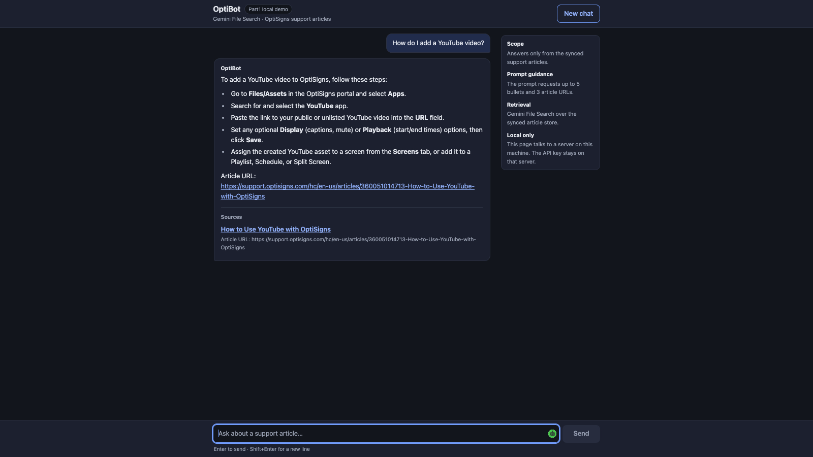

# Support Knowledge Sync

A Python job that turns the OptiSigns Help Center into a Gemini File Search knowledge base, syncs changes daily and answers questions with article citations.

**Flow:** Zendesk API → Markdown → File Search → cited answers.

## Quick start

Requires **Python 3.12** and a Gemini API key with File Search access. From the cloned repository root:

```bash
python3.12 -m venv .venv
.venv/bin/python -m pip install -r requirements-dev.txt
cp .env.sample .env
```

Set `GEMINI_API_KEY` in `.env` (`API_KEY` also works). Never commit it. API calls may incur charges.

```bash
.venv/bin/python main.py
.venv/bin/python -m kbsync.ask "How do I add a YouTube video?"
.venv/bin/python -m pytest -q
```

The job creates or reuses `support-articles`, writes Markdown to `data/articles/`, and exits **0** on success or **1** on failure. An unchanged rerun reports `added=0 updated=0 skipped=N`.

## Docker and demo

```bash
docker build -t sync-job .
docker run --rm --env-file .env sync-job
```

Runs once, without a volume. Also accepts `-e API_KEY=...`. For a key-free scrape: `.venv/bin/python -m kbsync.scrape`. For the local UI: `.venv/bin/python -m kbsync.web`, then http://127.0.0.1:8080. The UI is unauthenticated and local only.

## Design

Headings, relative links and code blocks are preserved. Article IDs and SHA-256 hashes drive delta sync. Remote metadata holds state. Replacements are indexed before old copies are deleted. Source removals have a deletion budget.

Chunking: **400 whitespace tokens, 50 overlap**, to retain short instructions and boundary context. `chunks_estimated` is a local estimate, **not a provider-reported count**. [Decisions](docs/DECISIONS.md).

## Deployment and evidence

Cloud Scheduler → Cloud Run at **02:23 UTC daily**, project `kbsync-7f3a`, `us-central1`. Secrets use Secret Manager. [Deploy](deploy/gcp/deploy.sh).

- [First upload](docs/logs/2026-11-06-first-full-sync-local.log): 398 articles, 942 estimated chunks, zero failures.
- [7 Nov scheduled run](docs/logs/2026-11-07T065056Z-kb-sync-x4b7h.log): 2 updated, 394 skipped, 2 removed, exit 0. [Trigger](docs/logs/2026-11-07-scheduler-clock.json).
- [Checklist](docs/CHECKLIST.md) · [CI](https://github.com/hoainho/quartz-lantern-7f3a/actions/workflows/tests.yml) · [Deviations](docs/SUBMISSION_NOTE.md) · [Answer transcript](docs/sanity-check.md).

**Screenshot:** real local UI, **not AI Studio**. This substitution and the estimated chunk count remain deviations. Click to enlarge.

<a href="docs/img/chat-ui.png"></a>
